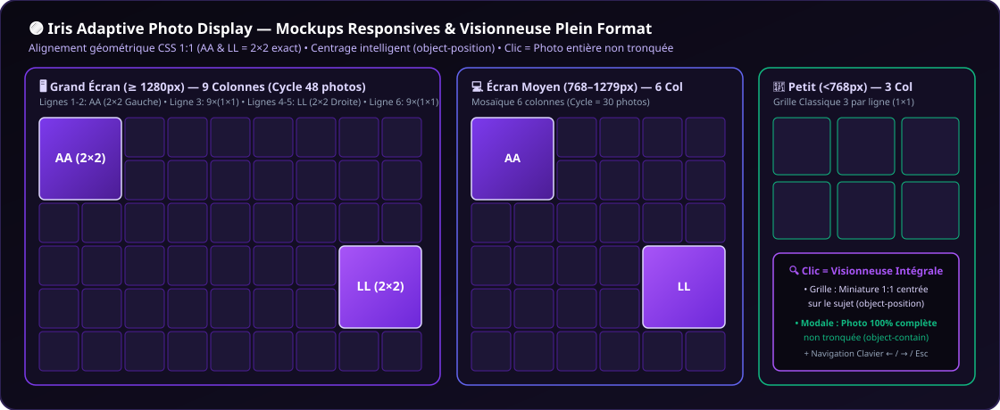

# 🟣 Iris • Plateforme de Cercles Visuels Privés

> **Sanctuaire privé pour la photographie, les créateurs humains et les cercles de confiance.**  
> Architecture sécurisée sur **Azure Cloud (.NET 8)** avec clients **Desktop Web (React)** et **Mobile (React Native Expo)**.

---

## 🌟 Vision & Differentiators

Iris comble le fossé entre les messageries instantanées (groupes fermés mais galeries inexploitables) et les réseaux sociaux publics saturés d'algorithmes et de robots de scraping (Instagram, X).

1. **Architecture Unifiée par Règles (`CirclePolicy`)** :
   - Tout repose sur une entité unique `Circle`, paramétrée dynamiquement (règles d'accès, quotas, politiques de modération).
2. **Bouclier Anti-IA & Sanctuaire Artiste** :
   - Interdiction stricte de l'IA paramétrable (`AiContentPolicy.StrictlyForbidden`).
   - Vérification matérielle à l'upload : extraction automatique de l'optique/boîtier (`📷 Sony A7IV • 35mm f/1.4 • ISO 100`) et **suppression automatique des coordonnées GPS**.
   - Preuve de travail humain (*WIP / Calques*).
3. **Protection Anti-Scraping Native** :
   - Zéro URL publique. Les médias sont stockés dans des conteneurs Azure Blob 100% privés et distribués via des **SAS Tokens signés éphémères (15 minutes)**.
4. **Mode Critique Constructive** :
   - Épinglage d'annotations techniques géolocalisées sur les coordonnées de l'image (*Composition*, *Couleur/Lumière*, *Technique*).
5. **Import & Archivage Social Universel** :
   - Importation en un clic depuis **Instagram**, **Cara Art**, **X/Twitter**, **Threads** ou **Reddit** avec conservation de l'attribution originale.
6. **Galerie Mosaïque Adaptative, Centrage Intelligent & Visionneuse Plein Format** :
   - **Disposition Responsive 3 Paliers** :
     - **Grand Écran (`≥ 1280px` — 9 colonnes)** : Cycle de `48` photos (`6N - 6`) alternant Focus `AA` en **2×2 à gauche**, ligne normale `1×1`, Focus `LL` en **2×2 à droite** (`grid-auto-flow: dense`), et ligne normale `1×1`.
     - **Écran Moyen (`768px – 1279px` — 6 colonnes)** : Mosaïque harmonieuse à 6 colonnes (Cycle de `30` photos avec `AA` et `LL` en `2×2`).
     - **Petit Écran (`< 768px` — 3 colonnes)** : Affichage classique **3 photos par ligne** (`1×1` uniforme).
   - **Centrage Intelligent sur le Sujet (`getSmartObjectPosition`)** : Les miniatures tronquées en `1:1` ajustent automatiquement leur `object-position: X% Y%` sur le point focal du sujet, le barycentre des épingles de critique, ou le tiers supérieur pour les portraits.
   - **Visionneuse Plein Format (`PhotoLightboxModal`)** : Un clic sur n'importe quelle miniature ouvre l'image originale **100% entière et non tronquée** (`object-contain`) avec ses métadonnées EXIF et navigation clavier (`←` / `→` / `Esc`).



---

## 🎨 Identité Visuelle : Obsidian & Electric Amethyst

* **Fond Sombre (`Deep Obsidian`)** : `#0A0812`
* **Surface Violette Élevée** : `#130E24`
* **Couleur Primaire (`Electric Amethyst`)** : `#7C3AED` & `#8B5CF6`
* **Accents & Textes (`Lavender Mist`)** : `#DDD6FE` & `#C4B5FD`
* **Badges Spécialisés** :
  * `📷 Matériel EXIF Vérifié` : `#10B981` (Émeraude)
  * `🎨 Preuve 100% Humain` : `#A855F7` (Pourpre)
  * `🔗 Import Social Réseau` : `#6366F1` (Indigo)

---

## 📂 Structure du Monorepo

```text
iris-platform/
├── backend/                  # ASP.NET Core (.NET 8 Clean Architecture)
│   ├── Iris.Domain/          # Entités, Enums & CirclePolicy
│   ├── Iris.Application/     # DTOs, Contrats & Interfaces
│   ├── Iris.Infrastructure/  # SAS Tokens Azure, Importer Social & Persistence
│   ├── Iris.Api/             # Minimal APIs REST & OpenAPI/Swagger
│   └── Iris.Tests/           # 33 Tests automatisés (97.6% Couverture)
├── web/                      # Client Desktop Web Studio (React + Vite + Tailwind)
│   ├── src/                  # Composants 3 colonnes, Canvas de Critique & Modals
│   ├── e2e/                  # Tests E2E Playwright (Chromium)
│   └── src/test/             # 13 Tests Vitest (92.6% Couverture)
├── mobile/                   # Application Mobile iOS & Android (React Native Expo)
│   ├── src/                  # Thème Amethyst, Gestures & Services API
│   └── src/test/             # 12 Tests Vitest (100% Couverture)
└── sonar-project.properties  # Configuration SonarQube / SonarCloud
```

---

## 🧪 Qualité de Code & Tests Automatisés (>90% Couverture)

| Projet | Framework | Tests | Couverture de Lignes | Statut |
| :--- | :--- | :--- | :--- | :--- |
| **Backend** | xUnit (.NET 8) + Coverlet | **33 Tests** | **97.60%** | 🟢 Conforme |
| **Desktop Web** | Vitest + React Testing Library | **16 Tests** | **94.52%** | 🟢 Conforme |
| **Mobile App** | Vitest | **13 Tests** | **100.00%** | 🟢 Conforme |
| **E2E UI** | Playwright (Chromium) | **6 Scénarios** | UI Complète | 🟢 Configuré |

### Lancer la suite de tests complète :
```bash
# 1. Backend .NET
dotnet test backend/Iris.Tests/Iris.Tests.csproj

# 2. Desktop Web
cd web && npm test

# 3. Mobile
cd mobile && npm test
```

---

## 🚀 Démarrage Rapide

### 1. Backend API
```bash
cd backend/Iris.Api
dotnet run
# Swagger UI disponible sur http://localhost:5000/swagger
```

### 2. Client Desktop Web
```bash
cd web
npm install
npm run dev
# Interface Studio disponible sur http://localhost:3000
```

### 3. Application Mobile Expo
```bash
cd mobile
npm install
npm run start
# Flashez le QR Code avec l'application mobile Expo Go (iOS ou Android)
```

---

## ⚖️ Usage & Propriété Intellectuelle (Non-Commercial Showcase)

> **Note importante / Portfolio Showcase Notice** :  
> Ce projet a été conçu à titre de **démonstrateur d'architecture logicielle et de vitrine technique (R&D / Portfolio)**. Il est mis à disposition uniquement à des fins d'évaluation technique, d'apprentissage et de démonstration. **Toute exploitation, redistribution ou utilisation à des fins commerciales est strictement interdite** sans l'accord écrit préalable de l'auteur.
>
> *This repository is an engineering & software architecture showcase developed for demonstration, educational, and technical evaluation purposes only. **Any commercial use, resale, or production monetization is strictly prohibited** without prior written authorization from the author.*
